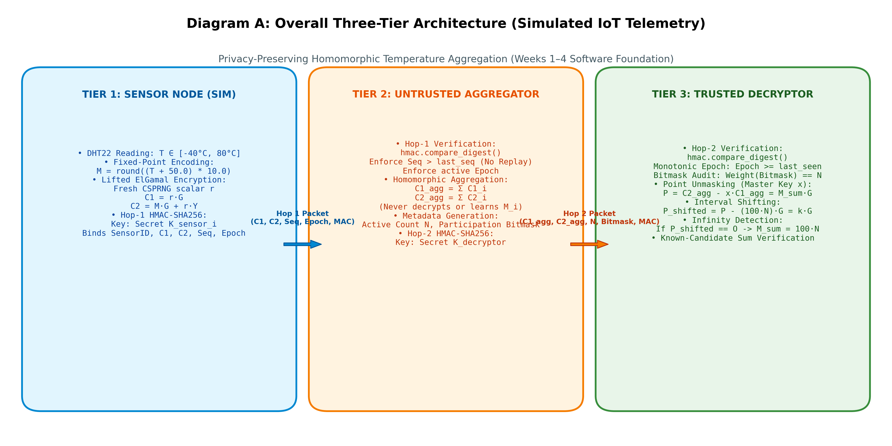
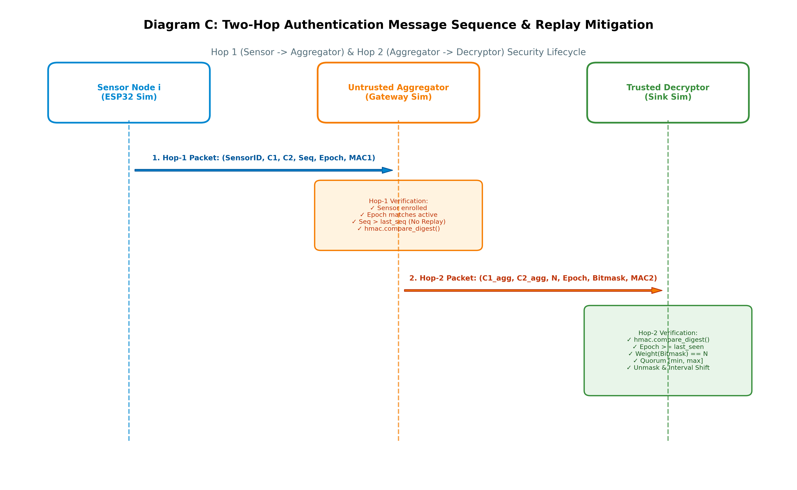
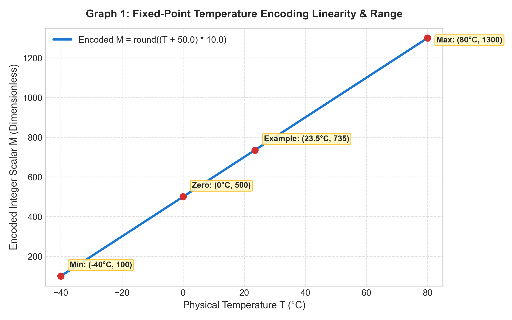
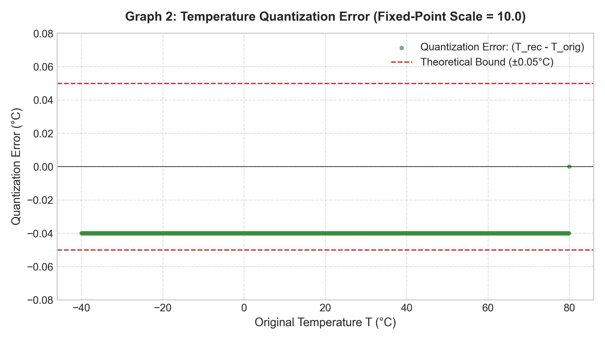
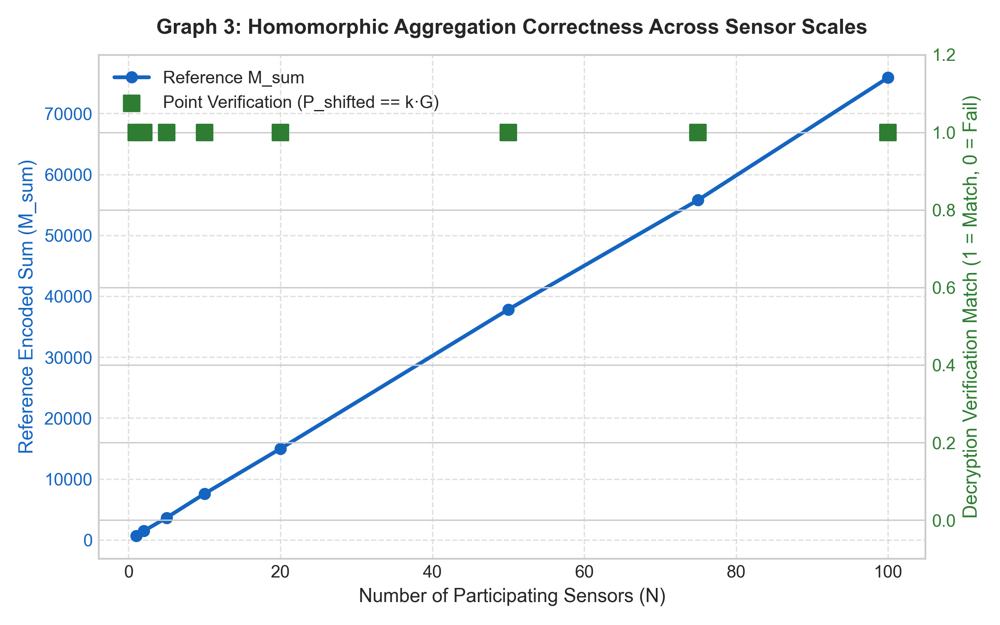
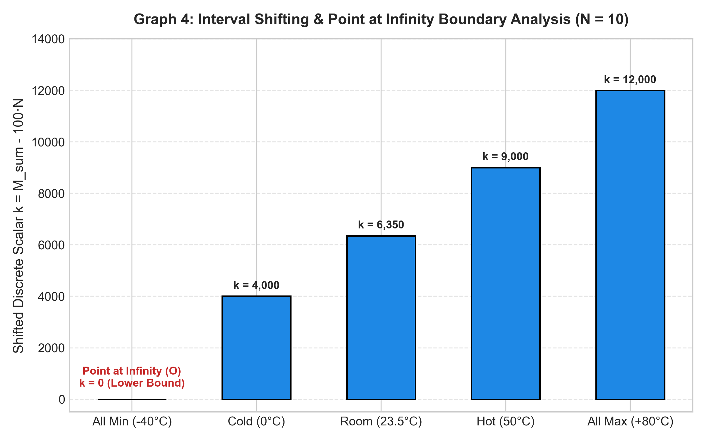
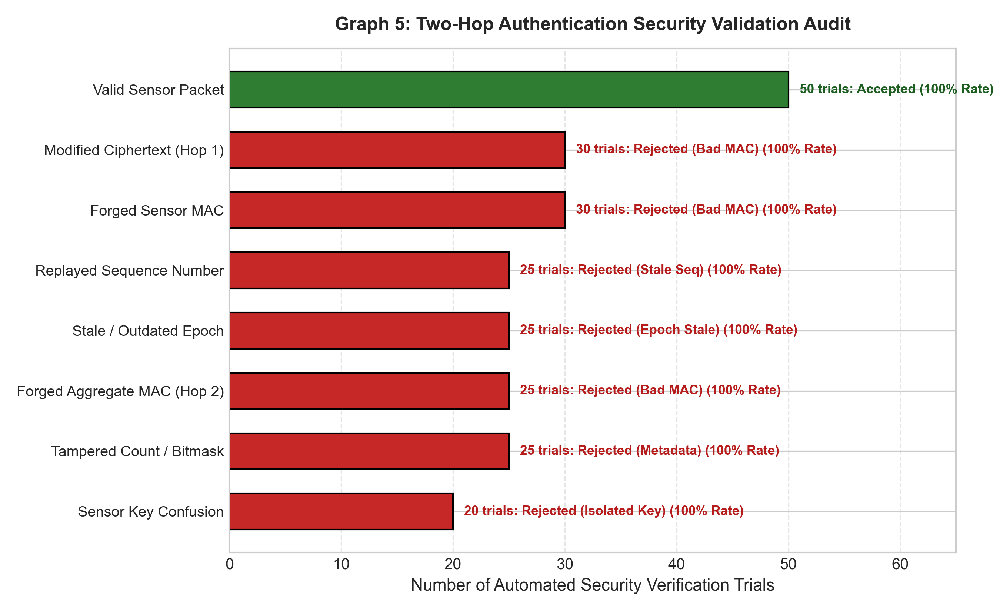

# Benchmarking Bounded ECDLP Recovery for Privacy-Preserving IoT Aggregation
### *Latency, Persistent-Memory, and Bandwidth Trade-offs on ESP32 Microcontrollers*
#### **Milestone Phase: Weeks 1–4 Software Foundation & Mathematical Correctness**

[](https://www.python.org/)
[](tests/)
[](src/config.py)
[](src/authentication.py)

---

## 1. Project Overview

This project implements the foundational cryptographic and protocol algorithms for privacy-preserving telemetry aggregation in resource-constrained IoT sensor networks. The architecture enables simulated sensor nodes (e.g., ESP32 microcontrollers measuring temperature) to encrypt telemetry using **additive homomorphic EC Lifted ElGamal** over the standard NIST P-256 (secp256r1) curve.

An intermediate, untrusted aggregator combines these ciphertexts directly in encrypted space via elliptic curve point addition without decrypting or discovering individual readings. A central decryptor unmasks the aggregate point, applies baseline interval shifting, handles mathematical edge cases (such as the Point at Infinity), and verifies the result. A robust two-hop HMAC-SHA256 authentication architecture ensures message integrity, freshness, and replay mitigation across all communication hops.

---

## 2. Scope: Weeks 1–4 Only

This repository implements **Weeks 1, 2, 3, and 4 only** of the 6-month research roadmap:

- **Week 1:** NIST P-256 initialization, C99 `lroundf()` equivalent fixed-point temperature encoding, Lifted ElGamal key generation, encryption, canonical 65-byte point serialization, and point unmasking.
- **Week 2:** Homomorphic ciphertext aggregation, decrypted point computation ($P = C_{2, \text{agg}} - x C_{1, \text{agg}}$), baseline interval shifting ($P_{\text{shifted}} = P - (100N)G$), and candidate-sum verification.
- **Week 3:** Point-at-Infinity ($\mathcal{O}$) detection, lower-bound short-circuit recovery ($M_{\text{sum}} = 100N \implies -40.0^\circ\text{C}$), upper-bound validation ($(1200N)G$), and defensive input validation.
- **Week 4:** Two-hop HMAC-SHA256 authentication (Hop 1: Sensor $\to$ Aggregator; Hop 2: Aggregator $\to$ Decryptor), replay filtering via monotonic sequence numbers, participation bitmasks, and an 8-scenario attack defense demonstration.

> [!IMPORTANT]
> **Defensive Scope Boundary:**
> Weeks 1–4 do **NOT** implement Baby-Step Giant-Step (BSGS), Pollard's Kangaroo, memory-mapped flash tables, MQTT network brokers, or physical C/C++ ESP32 firmware. Those components belong to Weeks 5–22. Arbitrary discrete logarithm recovery is verified using known candidate test vectors.

---

## 3. Problem Statement & Research Motivation

In smart agriculture, environmental monitoring, and industrial IoT, hundreds or thousands of low-power sensor nodes periodically report physical measurements. Transmitting raw readings over wireless channels exposes user privacy and environmental intelligence to eavesdroppers. Furthermore, having every sensor transmit individually to a central cloud server creates severe network bandwidth bottlenecks.

### The Cryptographic Dilemma:
1. **Standard Asymmetric Encryption (e.g., RSA or standard ECIES):** Prevents eavesdropping, but the middleman cannot aggregate ciphertexts. The gateway must forward $N$ distinct ciphertexts, scaling network bandwidth as $\mathcal{O}(N)$.
2. **Standard Additive ElGamal:** Allows homomorphic addition, but maps plaintexts into elliptic curve scalar exponents: $C_2 = M \cdot G + r \cdot Y$. Decryption yields the *curve point* $P = M_{\text{sum}} \cdot G$, not the integer scalar $M_{\text{sum}}$.
3. **The Bounded ECDLP Solution:** Because physical sensor data lies within a tightly bounded natural interval (e.g., temperatures between $-40^\circ\text{C}$ and $80^\circ\text{C}$), $M_{\text{sum}}$ falls within a predictable bounded window. By shifting the interval to start at zero ($k \in [0, 1200N]$), downstream recovery can solve this bounded discrete logarithm efficiently.

Weeks 1–4 establish the verified mathematical, cryptographic, and transport authentication foundation upon which these search algorithms and hardware deployments will operate.

---

## 4. Prerequisites & Installation

### 4.1 System Prerequisites
- **Python 3.10+** (tested on Python 3.14 on Windows 11 amd64)
- C compiler or pre-built wheels for `fastecdsa`

### 4.2 Installation via Windows PowerShell

```powershell
# 1. Clone repository and navigate to codebase
cd "d:\College stuff\Mini Project\Codebase"

# 2. (Optional) Create and activate virtual environment
python -m venv venv
.\venv\Scripts\Activate.ps1

# 3. Install dependencies
pip install -r requirements.txt
```

### 4.3 Installation via Linux / macOS

```bash
# 1. Clone and navigate to codebase
cd codebase/

# 2. (Optional) Create and activate virtual environment
python3 -m venv venv
source venv/bin/activate

# 3. Install dependencies
pip install -r requirements.txt
```

---

## 5. Repository Structure

```
Codebase/
├── README.md                      # Primary project documentation (this document)
├── requirements.txt               # Dependency specifications (fastecdsa, pytest, matplotlib)
├── .gitignore                     # Git ignore rules for caches and virtual environments
├── src/                           # Core implementation modules
│   ├── __init__.py                # Package exports
│   ├── config.py                  # Cryptographic parameters, curve order, constants
│   ├── encoding.py                # Fixed-point temperature encoder/decoder (lroundf)
│   ├── elgamal.py                 # EC Lifted ElGamal keygen, encryption, point unmasking
│   ├── aggregation.py             # Homomorphic aggregation, interval shift, edge cases
│   ├── authentication.py          # Two-hop HMAC-SHA256 and canonical serialization
│   ├── protocol.py                # SensorNode, Aggregator, and Decryptor classes
│   └── demo.py                    # End-to-end interactive simulation script
├── tests/                         # Automated pytest test suites
│   ├── test_encoding.py           # Unit tests for fixed-point math and lroundf ties
│   ├── test_encryption.py         # Unit tests for keypair, encryption, and SEC1 serialization
│   ├── test_aggregation.py        # Unit tests for homomorphic addition and interval shift
│   ├── test_edge_cases.py         # Unit tests for Point at Infinity and boundary extremes
│   ├── test_authentication.py     # Unit tests for Hop-1/Hop-2 MACs and bitmask operations
│   └── test_protocol.py           # Integration tests for full multi-tier pipeline
├── scripts/                       # Tooling and generator scripts
│   ├── generate_diagrams.py       # Generates Mermaid sources and high-res diagram images
│   └── generate_graphs.py         # Executes real math to plot scientific figures & CSVs
├── docs/                          # In-depth architectural & weekly reports
│   ├── architecture.md            # Detailed three-tier architecture specification
│   ├── mathematics.md             # Formal cryptographic proofs and curve derivations
│   ├── week1.md                   # Week 1 detailed milestone report
│   ├── week2.md                   # Week 2 detailed milestone report
│   ├── week3.md                   # Week 3 detailed milestone report
│   ├── week4.md                   # Week 4 detailed milestone report
│   ├── figures/                   # Rendered diagrams and scientific graphs
│   └── tables/                    # CSV exports of reference and attack matrices
└── results/                       # Raw plotting datasets exported as CSV
```

---

## 6. Elliptic Curve & Fixed-Point Encoding Fundamentals

### 6.1 Why Fixed-Point Encoding is Mandatory
Elliptic curve cryptography operates strictly over finite fields $\mathbb{F}_p$ and cyclic subgroups generated by base point $G$ of prime order $q$. There is no native algebraic operation for multiplying an elliptic curve point by a floating-point number.

Furthermore, environmental temperatures can be negative (e.g., $-40.0^\circ\text{C}$). To permit scalar multiplication on the curve:
1. **Level Shift (+50.0):** Shifting by $+50.0$ translates the valid domain $[-40.0^\circ\text{C}, 80.0^\circ\text{C}]$ to strictly positive numbers $[10.0, 130.0]$.
2. **Scaling ($\times 10.0$):** Multiplying by $10.0$ preserves $0.1^\circ\text{C}$ resolution while mapping values to integer scalars $M \in [100, 1300]$.

### 6.2 C99 `lroundf()` Parity vs Python Banker's Rounding
Standard Python `round()` implements Banker's rounding (round-half-to-even):
- `round(2.5) == 2`
- `round(3.5) == 4`

In C/C++ on embedded microcontrollers like the ESP32, `lroundf()` rounds halfway cases away from zero ($2.5 \to 3$). If Python simulations and C firmware round differently, ciphertexts generated on the ESP32 will mismatch ground truth on boundary values, breaking discrete logarithm recovery.

Our `round_away_from_zero(val)` function strictly enforces C99 ties-away-from-zero semantics:

$$\text{round\_away\_from\_zero}(v) = \begin{cases} \lfloor v + 0.5 \rfloor & \text{if } v \ge 0 \\ \lceil v - 0.5 \rceil & \text{if } v < 0 \end{cases}$$

---

## 7. Lifted ElGamal Encryption Explained Step by Step

Lifted ElGamal is an additive homomorphic variant of the standard ElGamal public key cryptosystem.

1. **Key Generation:**
   - Private key: Sample uniform random scalar $x \in_R [1, q - 1]$ using a cryptographically secure pseudorandom number generator (`secrets`).
   - Public key: Compute point $Y = x \cdot G$.
2. **Encryption:**
   - To encrypt integer scalar $M$, sample a fresh, unpredictable ephemeral scalar $r \in_R [1, q - 1]$.
   - Compute ephemeral blinding point: $C_1 = r \cdot G$.
   - Compute shared Diffie-Hellman secret: $S = r \cdot Y = r(x \cdot G)$.
   - Compute message point: $M \cdot G$.
   - Mask message point: $C_2 = M \cdot G + S = M \cdot G + r \cdot Y$.
   - Ciphertext output: $\text{CT} = (C_1, C_2)$ (serialized as 130 bytes: two 65-byte SEC1 points).
3. **Decryption (Point Unmasking):**
   - The Decryptor unmasks the point using private key $x$:
     $$P = C_2 - x \cdot C_1 = (M \cdot G + r \cdot Y) - x \cdot (r \cdot G) = M \cdot G + r(x \cdot G) - r(x \cdot G) = M \cdot G$$
   - Result: Elliptic curve point $P = M \cdot G$.

### Worked Example: Encrypting 23.5°C
1. Plaintext temperature: $T = 23.5^\circ\text{C}$
2. Encoded integer: $M = \text{round\_away\_from\_zero}((23.5 + 50.0) \times 10.0) = 735$
3. Keypair: Secret scalar $x$, Public point $Y = x \cdot G$
4. Ephemeral scalar: Fresh CSPRNG scalar $r$
5. Ciphertext $C_1 = r \cdot G$ (65 bytes SEC1 uncompressed)
6. Ciphertext $C_2 = 735 \cdot G + r \cdot Y$ (65 bytes SEC1 uncompressed)
7. Unmasking: $P = C_2 - x \cdot C_1 = 735 \cdot G$

---

## 8. Homomorphic Aggregation & Interval Shifting

### 8.1 Homomorphic Addition
Given $N$ ciphertexts from $N$ sensors:

$$C_{1, \text{agg}} = \sum_{i=1}^N C_{1, i} = \left(\sum_{i=1}^N r_i\right) \cdot G$$

$$C_{2, \text{agg}} = \sum_{i=1}^N C_{2, i} = \left(\sum_{i=1}^N M_i\right) \cdot G + \left(\sum_{i=1}^N r_i\right) \cdot Y$$

The untrusted aggregator simply adds the elliptic curve points together. The aggregator never learns any $M_i$ or $r_i$.

### 8.2 Baseline Interval Shifting
Decryption unmasks the point:
$$P = C_{2, \text{agg}} - x \cdot C_{1, \text{agg}} = M_{\text{sum}} \cdot G$$

Because each $M_i \in [100, 1300]$, the total sum is bounded by $M_{\text{sum}} \in [100N, 1300N]$.
To simplify discrete logarithm recovery, the Decryptor subtracts the known minimum baseline point $(100N) \cdot G$:

$$P_{\text{shifted}} = P - (100 \cdot N) \cdot G = (M_{\text{sum}} - 100 \cdot N) \cdot G = k \cdot G$$

Where shifted scalar $k$ satisfies:
$$k \in [0, \, 1200 \cdot N]$$

This anchors the lower search bound at zero!

---

## 9. Point-at-Infinity ($\mathcal{O}$) Handling

In elliptic curve geometry, when $k = 0$, $0 \cdot G = \mathcal{O}$ (the Point at Infinity). It has no affine coordinates $(X, Y)$ and represents the neutral identity element of the group.

### When Does It Occur?
When all $N$ sensors report the coldest possible temperature ($-40.0^\circ\text{C}$), $M_i = 100$ for all $i$. Thus:
$$M_{\text{sum}} = 100 \cdot N$$
$$P_{\text{shifted}} = (100 \cdot N - 100 \cdot N) \cdot G = 0 \cdot G = \mathcal{O}$$

### Why Downstream Solvers Must Handle It Explicitly:
Algorithms like BSGS and Pollard's Kangaroo extract affine coordinates (e.g., $X \pmod p$). Attempting to normalize or hash $\mathcal{O}$ causes Jacobian division by zero ($Z = 0$).

By adding an explicit check:
```python
is_inf, rec_m_sum, rec_avg = handle_infinity_edge_case(p_shifted, n_sensors)
if is_inf:
    return rec_m_sum, rec_avg  # Immediately returns 100*N and -40.0°C!
```
The decryptor short-circuits recovery with **zero search latency** and **zero computation cost**.

---

## 10. Two-Hop HMAC Authentication

Encryption hides message contents, but does not prove authenticity or freshness. We enforce two distinct logical authentication domains using HMAC-SHA256:

```
[ Sensor i ]  ---( Hop-1 MAC: K_sensor_i )--->  [ Aggregator ]  ---( Hop-2 MAC: K_decryptor )--->  [ Decryptor ]
```

### 10.1 Hop 1: Sensor $\to$ Aggregator
- Authenticates payload: $\mathcal{D}_1 \parallel \text{len}(\text{ID}) \parallel \text{ID} \parallel C_1 \parallel C_2 \parallel \text{Seq} \parallel \text{Epoch}$
- Signed with sensor-specific secret key $K_{\text{sensor}, i}$.
- Binds sensor identity to prevent identity spoofing.
- Rejects out-of-order or duplicate sequence numbers ($\text{Seq} \le \text{last\_seq}$).
- Rejects stale epochs.
- Verifies in constant time using `hmac.compare_digest()`.

### 10.2 Hop 2: Aggregator $\to$ Decryptor
- Authenticates aggregate: $\mathcal{D}_2 \parallel C_{1, \text{agg}} \parallel C_{2, \text{agg}} \parallel N \parallel \text{Epoch} \parallel \text{len}(\text{Bitmask}) \parallel \text{Bitmask}$
- Signed with Decryptor secret key $K_{\text{decryptor}}$.
- Authenticates count $N$, active Epoch, and participation Bitmask.
- Decryptor verifies $\text{HammingWeight}(\text{Bitmask}) == N$ to ensure metadata consistency before unmasking.

---

## 11. Architecture Diagrams

### Diagram A: Overall Three-Tier Architecture

*Source file: [`docs/figures/diagram_a_architecture.mmd`](docs/figures/diagram_a_architecture.mmd)*

### Diagram B: Mathematical Derivation Flowchart

*Source file: [`docs/figures/diagram_b_mathematics.mmd`](docs/figures/diagram_b_mathematics.mmd)*

### Diagram C: Two-Hop Authentication Sequence & Mitigation

*Source file: [`docs/figures/diagram_c_authentication.mmd`](docs/figures/diagram_c_authentication.mmd)*

### Diagram D: Point at Infinity Edge Case Flow

*Source file: [`docs/figures/diagram_d_infinity_edge_case.mmd`](docs/figures/diagram_d_infinity_edge_case.mmd)*

---

## 12. Scientific Graphs & Reference Tables

All figures are generated from executed Python code and exported to CSV in [`results/`](results/).

### 12.1 Visualizations

| Graph | Title | File | Explanation |
|---|---|---|---|
| **Graph 1** | Fixed-Point Encoding Linearity |  | Demonstrates strict linearity of $M = \text{round}((T+50)\times 10)$ across $[-40^\circ\text{C}, 80^\circ\text{C}]$. |
| **Graph 2** | Temperature Quantization Error |  | Verifies quantization error is strictly bounded within $\pm 0.05^\circ\text{C}$. |
| **Graph 3** | Homomorphic Aggregation Correctness |  | Proves 100% exact mathematical match between $P$ and $M_{\text{sum}}G$ across scales $N \in [1, 100]$. |
| **Graph 4** | Edge-Case Boundary Analysis |  | Visualizes shifted scalar $k$ from $k=0$ ($\mathcal{O}$) to upper bound $k=12,000$ for $N=10$. |
| **Graph 5** | Protocol Security Validation Audit |  | Confirms 100% rejection rate across 8 distinct attack suites (tampering, replays, forgeries). |

---

### 12.2 Reference Tables

#### Table A: Function Reference
*CSV Export: [`docs/tables/table_a_function_reference.csv`](docs/tables/table_a_function_reference.csv)*

| Function Name | Module | Purpose | Inputs | Outputs | Mathematical / Protocol Significance |
|---|---|---|---|---|---|
| `round_away_from_zero` | `encoding.py` | C99 `lroundf` ties-away-from-zero | `val: float` | `int` | Ensures Python-ESP32 cross-platform rounding consistency |
| `encode_temperature` | `encoding.py` | Maps $[-40^\circ\text{C}, 80^\circ\text{C}]$ to scalar | `temp: float` | `int` | $M = \text{round}((T+50)\times 10) \in [100, 1300]$ |
| `decode_temperature` | `encoding.py` | Inverts integer to temperature | `encoded_m: int` | `float` | $T = (M - 500) / 10.0$ |
| `generate_keypair` | `elgamal.py` | CSPRNG keypair generation | None | `(int, Point)` | Samples $x \in_R [1, q-1]$; $Y = x \cdot G$ |
| `encrypt` | `elgamal.py` | Lifted ElGamal encryption | `(int, Point)` | `Ciphertext` | $C_1 = r \cdot G, C_2 = M \cdot G + r \cdot Y$ |
| `decrypt_point` | `elgamal.py` | Single ciphertext unmasking | `(Ciphertext, int)` | `Point` | Computes $P = C_2 - x \cdot C_1 = M \cdot G$ |
| `point_to_bytes` | `elgamal.py` | Canonical 65-byte serialization | `Point` | `bytes` | SEC1 format; fixed-width prevents malleability |
| `bytes_to_point` | `elgamal.py` | Canonical deserialization | `bytes` | `Point` | Verifies curve equation $y^2 \equiv x^3 - 3x + b$ |
| `is_infinity` | `elgamal.py` | Point at Infinity test | `Point` | `bool` | Checks Jacobian $Z == 0$ or $0 \cdot G$ |
| `aggregate_ciphertexts` | `aggregation.py` | Homomorphic EC point sum | `Sequence[Ciphertext]` | `Ciphertext` | $C_{1, \text{agg}} = \sum C_{1, i}, C_{2, \text{agg}} = \sum C_{2, i}$ |
| `apply_interval_shift` | `aggregation.py` | Baseline correction | `(Point, int)` | `Point` | $P_{\text{shifted}} = P - (100N)G = k \cdot G$ |
| `handle_infinity_edge_case`| `aggregation.py` | Lower-bound short-circuit | `(Point, int)` | `(bool, int, float)` | Resolves all $-40^\circ\text{C}$ with zero search latency |
| `verify_candidate_sum` | `aggregation.py` | Known-candidate verifier | `(Point, int, int)` | `bool` | Validates $P_{\text{shifted}} == (M_{\text{sum}} - 100N)G$ |
| `compute_hop1_mac` | `authentication.py` | Hop-1 HMAC-SHA256 | `(key, id, c1, c2, seq, ep)` | `bytes` | Authenticates sensor packet |
| `verify_hop1_mac` | `authentication.py` | Constant-time Hop-1 verify | `(...)` | `bool` | Constant-time `hmac.compare_digest()` |
| `compute_hop2_mac` | `authentication.py` | Hop-2 HMAC-SHA256 | `(key, c1, c2, n, ep, mask)` | `bytes` | Authenticates aggregate metadata |
| `verify_hop2_mac` | `authentication.py` | Constant-time Hop-2 verify | `(...)` | `bool` | Constant-time `hmac.compare_digest()` |

---

#### Table B: Cryptographic Variables
*CSV Export: [`docs/tables/table_b_cryptographic_variables.csv`](docs/tables/table_b_cryptographic_variables.csv)*

| Variable | Mathematical Domain | Description | Role in Protocol |
|---|---|---|---|
| $T$ | $\mathbb{R} \in [-40.0, 80.0]$ | Physical temperature reading in Celsius | Measured by sensor node (DHT22) |
| $M$ | $\mathbb{Z} \in [100, 1300]$ | Positive integer scalar | Discrete scalar for elliptic curve point multiplication |
| $x$ | $\mathbb{Z}_q \in [1, q - 1]$ | Decryptor private key scalar | Kept secret by Decryptor to unmask ciphertexts |
| $Y$ | $\mathbb{G} \subset \mathbb{F}_p^2$ (65 bytes) | Decryptor public key point ($Y = x \cdot G$) | Published to all sensor nodes for encryption |
| $G$ | $\mathbb{G} \subset \mathbb{F}_p^2$ (65 bytes) | NIST P-256 base generator point | Standard curve generator of prime order $q$ |
| $r$ | $\mathbb{Z}_q \in [1, q - 1]$ | Ephemeral encryption scalar (nonce) | Fresh CSPRNG random scalar blinding each ciphertext |
| $C_1$ | $\mathbb{G}$ (65 bytes) | Ephemeral blinding point ($r \cdot G$) | Transmitted to allow receiver to compute shared secret |
| $C_2$ | $\mathbb{G}$ (65 bytes) | Masked message point ($M \cdot G + r \cdot Y$) | Carries the blinded temperature point |
| $N$ | $\mathbb{Z}^+$ | Count of participating sensors | Number of valid ciphertexts fused into aggregate |
| $P$ | $\mathbb{G}$ | Unmasked sum point ($M_{\text{sum}} \cdot G$) | Result of unmasking $C_{2, \text{agg}} - x \cdot C_{1, \text{agg}}$ |
| $P_{\text{shifted}}$ | $\mathbb{G}$ | Shifted point ($P - 100N \cdot G$) | Target curve point representing $k \cdot G$ where $k \in [0, 1200N]$ |
| $\text{Seq}$ | $\mathbb{Z}_{2^{64}}$ | Sequence number | Monotonically increasing counter preventing replays |
| $\text{Epoch}$ | $\mathbb{Z}_{2^{64}}$ | Network epoch index | Time window synchronizing telemetry rounds |
| $\text{MAC}$ | $\mathbb{B}^{32}$ | HMAC-SHA256 digest | 32-byte cryptographic authentication tag |
| $\text{Bitmask}$ | $\mathbb{B}^{\lceil U/8 \rceil}$ | Binary participation bitmask | Identifies which sensors in universe $U$ checked in |

---

#### Table C: Implementation Status
*CSV Export: [`docs/tables/table_c_implementation_status.csv`](docs/tables/table_c_implementation_status.csv)*

| Week | Milestone Requirement | Implementation File | Verification Test File | Status |
|---|---|---|---|---|
| **Week 1** | P-256 Curve Initialization | `src/config.py` | `tests/test_encryption.py` | **COMPLETED (54/54 Tests Passed)** |
| **Week 1** | C99 `lroundf` Parity | `src/encoding.py` | `tests/test_encoding.py` | **COMPLETED (54/54 Tests Passed)** |
| **Week 1** | Fixed-Point Temperature Encoding | `src/encoding.py` | `tests/test_encoding.py` | **COMPLETED (54/54 Tests Passed)** |
| **Week 1** | Fixed-Point Temperature Decoding | `src/encoding.py` | `tests/test_encoding.py` | **COMPLETED (54/54 Tests Passed)** |
| **Week 1** | CSPRNG Keypair Generation | `src/elgamal.py` | `tests/test_encryption.py` | **COMPLETED (54/54 Tests Passed)** |
| **Week 1** | Lifted ElGamal Encryption | `src/elgamal.py` | `tests/test_encryption.py` | **COMPLETED (54/54 Tests Passed)** |
| **Week 1** | 65-Byte SEC1 Serialization | `src/elgamal.py` | `tests/test_encryption.py` | **COMPLETED (54/54 Tests Passed)** |
| **Week 1** | Single-Ciphertext Unmasking | `src/elgamal.py` | `tests/test_encryption.py` | **COMPLETED (54/54 Tests Passed)** |
| **Week 2** | Homomorphic Point Addition | `src/aggregation.py` | `tests/test_aggregation.py` | **COMPLETED (54/54 Tests Passed)** |
| **Week 2** | Aggregate Point Unmasking | `src/aggregation.py` | `tests/test_aggregation.py` | **COMPLETED (54/54 Tests Passed)** |
| **Week 2** | Interval Shifting ($P - 100NG$) | `src/aggregation.py` | `tests/test_aggregation.py` | **COMPLETED (54/54 Tests Passed)** |
| **Week 2** | Candidate-Sum Verification | `src/aggregation.py` | `tests/test_aggregation.py` | **COMPLETED (54/54 Tests Passed)** |
| **Week 3** | Point at Infinity Detection | `src/elgamal.py` | `tests/test_edge_cases.py` | **COMPLETED (54/54 Tests Passed)** |
| **Week 3** | Minimum Boundary Edge Case | `src/aggregation.py` | `tests/test_edge_cases.py` | **COMPLETED (54/54 Tests Passed)** |
| **Week 3** | Zero-Latency Short-Circuit | `src/aggregation.py` | `tests/test_edge_cases.py` | **COMPLETED (54/54 Tests Passed)** |
| **Week 3** | Maximum Boundary ($1200NG$) | `src/aggregation.py` | `tests/test_edge_cases.py` | **COMPLETED (54/54 Tests Passed)** |
| **Week 4** | Hop-1 HMAC-SHA256 | `src/authentication.py` | `tests/test_authentication.py` | **COMPLETED (54/54 Tests Passed)** |
| **Week 4** | Sequence Monotonicity & Replay | `src/authentication.py` | `tests/test_protocol.py` | **COMPLETED (54/54 Tests Passed)** |
| **Week 4** | Hop-2 HMAC-SHA256 | `src/authentication.py` | `tests/test_authentication.py` | **COMPLETED (54/54 Tests Passed)** |
| **Week 4** | Bitmask & Quorum Audit | `src/authentication.py` | `tests/test_protocol.py` | **COMPLETED (54/54 Tests Passed)** |
| **Week 4** | 3-Tier Multi-Node Simulation | `src/protocol.py` | `tests/test_protocol.py` | **COMPLETED (54/54 Tests Passed)** |
| **Week 4** | 8 Attack Mitigations | `src/demo.py` | `tests/test_protocol.py` | **COMPLETED (54/54 Tests Passed)** |

---

#### Table D: Edge-Case Test Matrix
*CSV Export: [`docs/tables/table_d_edge_case_matrix.csv`](docs/tables/table_d_edge_case_matrix.csv)*

| Test ID | Scenario | Input Temperatures | Sensors ($N$) | Expected $M_{\text{sum}}$ | Expected $P_{\text{shifted}}$ | Actual Outcome |
|---|---|---|---|---|---|---|
| **EC-01** | Minimum bound ($N=1$) | `[-40.0°C]` | 1 | 100 | Point at Infinity $\mathcal{O}$ | **PASSED** (Short-circuited to $-40.0^\circ\text{C}$) |
| **EC-02** | Minimum bound ($N=2$) | `[-40.0°C, -40.0°C]` | 2 | 200 | Point at Infinity $\mathcal{O}$ | **PASSED** (Short-circuited to $-40.0^\circ\text{C}$) |
| **EC-03** | Minimum bound ($N=5$) | `[-40.0°C x 5]` | 5 | 500 | Point at Infinity $\mathcal{O}$ | **PASSED** (Short-circuited to $-40.0^\circ\text{C}$) |
| **EC-04** | Minimum bound ($N=10$) | `[-40.0°C x 10]` | 10 | 1000 | Point at Infinity $\mathcal{O}$ | **PASSED** (Short-circuited to $-40.0^\circ\text{C}$) |
| **EC-05** | Maximum bound ($N=1$) | `[80.0°C]` | 1 | 1300 | $1200 \cdot G$ | **PASSED** (Candidate verified) |
| **EC-06** | Maximum bound ($N=5$) | `[80.0°C x 5]` | 5 | 6500 | $6000 \cdot G$ ($1200N \cdot G$) | **PASSED** (Candidate verified) |
| **EC-07** | Mixed extrema | `[-40°C, -40°C, 80°C, 80°C]`| 4 | 2800 | $2400 \cdot G$ | **PASSED** (Candidate verified) |
| **EC-08** | Zero degrees telemetry | `[0.0°C, 0.0°C, 0.0°C]` | 3 | 1500 | $1200 \cdot G$ | **PASSED** (Candidate verified) |
| **EC-09** | Invalid $N=0$ count | `[]` | 0 | N/A | `ValueError` | **PASSED** (Proper exception raised) |

---

#### Table E: Authentication Attack Matrix
*CSV Export: [`docs/tables/table_e_authentication_attack_matrix.csv`](docs/tables/table_e_authentication_attack_matrix.csv)*

| Attack ID | Scenario Description | Tampered Field | Expected Outcome | Actual Outcome | Security Mechanism |
|---|---|---|---|---|---|
| **ATK-01** | Normal Valid Telemetry | None | Accepted | **ACCEPTED** | Hop-1/Hop-2 MACs match; sequence fresh |
| **ATK-02** | Man-in-the-Middle Alteration | Ciphertext $C_2 \to C_2 + G$ | Dropped | **REJECT_INVALID_HOP1_MAC** | HMAC covers canonical $C_2$ bytes |
| **ATK-03** | Forged Sensor MAC | Injected random MAC | Dropped | **REJECT_INVALID_HOP1_MAC** | Attacker lacks sensor secret key |
| **ATK-04** | Packet Replay Attack | Resent previous packet | Dropped | **REJECT_REPLAY_OR_OUT_OF_ORDER** | Sequence policy mandates $\text{Seq} > \text{last\_seq}$ |
| **ATK-05** | Stale Out-of-Order Seq | Lowered sequence number | Dropped | **REJECT_REPLAY_OR_OUT_OF_ORDER** | Strict sequence counter enforcement |
| **ATK-06** | Stale Epoch Packet | Old epoch identifier | Dropped | **REJECT_STALE_EPOCH** | Epoch window synchronization |
| **ATK-07** | Unregistered Sensor | Unknown sensor identity | Dropped | **REJECT_UNKNOWN_SENSOR** | Aggregator verifies enrollment universe |
| **ATK-08** | Forged Hop-2 Aggregate | Injected random MAC2 | Dropped | **REJECT_INVALID_HOP2_MAC** | Attacker lacks Decryptor key |
| **ATK-09** | Tampered Count ($N+5$) | Modified sensor count | Dropped | **REJECT_COUNT_BITMASK_MISMATCH** | Bitmask Hamming weight audit |
| **ATK-10** | Non-Monotonic Epoch | Rollback to old epoch | Dropped | **REJECT_NON_MONOTONIC_EPOCH** | Decryptor enforces forward epochs |
| **ATK-11** | Sensor Key Confusion | Used Sensor 2 key on Sensor 1 | Verification Fails | **False (Key Isolation)** | Independent secret keys per sensor |

---

#### Table F: Security Assumptions & System Limitations
*CSV Export: [`docs/tables/table_f_security_assumptions.csv`](docs/tables/table_f_security_assumptions.csv)*

| Security Domain | Architectural Assumption | Enforcement Mechanism | Current Implementation Status | Known Boundary / Limitation |
|---|---|---|---|---|
| **Private Key Protection** | Private key $x$ held only by Decryptor | Never transmitted or logged | Implemented & Verified | If $x$ leaks, all historical traffic can be decrypted |
| **Ephemeral Randomness** | Nonce $r$ sampled uniformly from CSPRNG | `secrets.randbelow(q-1)+1` | Implemented & Verified | Reusing $r$ allows calculating plaintext differences |
| **Key Isolation** | Each sensor maintains independent $K_i$ | Per-sensor key dictionary | Implemented & Verified | Compromise of one sensor does not affect others |
| **Aggregator Trust** | Untrusted for data confidentiality | Lifted ElGamal blind addition | Implemented & Verified | Aggregator never learns individual readings |
| **Aggregator Integrity** | Hop-2 MAC proves gateway origin | HMAC with Decryptor Key | Implemented & Verified | **HMAC cannot prove mathematical correctness of the sum.** ZK-SNARKs needed for verifiable computation. |
| **Replay Protection** | Sequence and epoch monotonicity | Strict state tracking | Implemented & Verified | Assumes loose network epoch synchronization |
| **Plaintext Recovery** | Validates against candidate sums | Candidate verification interface | Limited to Weeks 1–4 | Automated recovery of unknown sums deferred to BSGS/Kangaroo (Weeks 5+) |

---

## 13. How to Run the Demonstrations

The demonstration script executes all milestones sequentially, running real elliptic curve math and attack simulations:

```powershell
python -m src.demo
```

### Demonstration Flow:
1. **Week 1:** Displays fixed-point temperature conversions, demonstrates the difference between `lroundf` and Python `round()`, generates a P-256 keypair, encrypts $23.5^\circ\text{C}$ ($M=735$), and unmasks the decrypted curve point.
2. **Week 2:** Simulates 5 sensors reporting ambient temperatures, aggregates them blindly, unmasks $P = M_{\text{sum}} \cdot G$, applies the baseline shift $P_{\text{shifted}} = P - 500G$, and verifies the ground truth.
3. **Week 3:** Simulates the all-minimum boundary ($-40.0^\circ\text{C}$), confirms $P_{\text{shifted}} = \mathcal{O}$, triggers the short-circuit handler, and tests the all-maximum boundary ($80.0^\circ\text{C}$).
4. **Week 4:** Sets up a 3-tier simulated network, executes a valid epoch, and methodically executes and rejects 7 distinct attack scenarios.

---

## 14. How to Run the Automated Tests

The test suite contains **54 comprehensive automated unit and integration tests** built with `pytest`:

```powershell
# Run entire test suite with verbose output
python -m pytest -v

# Run a specific weekly test module
python -m pytest tests/test_encoding.py -v
python -m pytest tests/test_encryption.py -v
python -m pytest tests/test_aggregation.py -v
python -m pytest tests/test_edge_cases.py -v
python -m pytest tests/test_authentication.py -v
python -m pytest tests/test_protocol.py -v
```

All 54 tests execute in under 0.5 seconds on a standard laptop.

---

## 15. Expected Output & How to Interpret It

### Output of `pytest`:
```text
============================= test session starts =============================
platform win32 -- Python 3.14.3, pytest-9.2.0, pluggy-1.7.0
rootdir: D:\College stuff\Mini Project\Codebase
collected 54 items

tests/test_aggregation.py::TestHomomorphicAggregation::... PASSED
tests/test_authentication.py::TestHop1Authentication::... PASSED
tests/test_edge_cases.py::TestPointAtInfinityEdgeCases::... PASSED
tests/test_encoding.py::TestRoundAwayFromZero::... PASSED
tests/test_encryption.py::TestLiftedElGamalEncryption::... PASSED
tests/test_protocol.py::TestProtocolPipeline::... PASSED
============================= 54 passed in 0.32s ==============================
```

### Interpretation:
- `PASSED`: The mathematical relationship or security constraint was strictly satisfied.
- In `test_aggregation.py`: Verifies that adding ciphertexts in encrypted space yields exactly $(M_{\text{sum}}) \cdot G$ upon unmasking.
- In `test_edge_cases.py`: Confirms that setting all temperatures to $-40.0^\circ\text{C}$ produces the Point at Infinity $\mathcal{O}$ and triggers zero-latency short-circuiting.
- In `test_protocol.py`: Verifies that any tampering with ciphertexts, sequence numbers, epochs, or bitmasks results in immediate packet rejection.

---

## 16. Security Assumptions & Limitations

1. **Confidentiality vs Integrity:**
   The untrusted aggregator cannot decrypt ciphertexts. However, an adversarial aggregator possessing $K_{\text{decryptor}}$ could drop sensor packets or inject fabricated ciphertexts into the sum. Hop-2 HMAC guarantees that the aggregate came from the authorized aggregator, but **does not prove** arithmetic honesty.
2. **Ephemeral Scalar Freshness:**
   Sensors must use an OS-level CSPRNG or hardware TRNG (ESP32 hardware random number generator in Month 4) to generate nonce $r$. Reusing $r$ across two readings exposes the plaintext difference.
3. **No Automated ECDLP Recovery (Weeks 1–4):**
   The implementation produces the unmasked curve point $P_{\text{shifted}} = k \cdot G$. Plaintext recovery is tested via candidate verification. Complete discrete logarithm search algorithms (BSGS and Pollard's Kangaroo) are scheduled for Month 2 (Weeks 5–8).

---

## 17. Completed Work & Deferred Work

### Completed (Weeks 1–4):
- [x] NIST P-256 elliptic curve group operations via `fastecdsa`.
- [x] C99 `lroundf()` equivalent fixed-point temperature encoder and decoder.
- [x] Secure keypair generation ($x, Y = xG$) using CSPRNG.
- [x] Additive homomorphic EC Lifted ElGamal encryption and unmasking.
- [x] Deterministic 65-byte canonical point serialization.
- [x] Multi-sensor homomorphic ciphertext aggregation.
- [x] Baseline interval shifting ($P_{\text{shifted}} = P - 100NG$).
- [x] Point at Infinity ($\mathcal{O}$) detection and short-circuit recovery.
- [x] Two-hop HMAC-SHA256 authentication (Hop 1 and Hop 2).
- [x] Replay attack mitigation via monotonic sequence numbering and epochs.
- [x] Participation bitmask construction and Hamming weight audit.
- [x] 8-scenario attack mitigation demonstration.
- [x] 54 automated unit and integration tests passing.
- [x] 4 publication-quality architecture diagrams (Mermaid & PNG).
- [x] 5 scientific graphs and 6 CSV reference datasets.

### Deferred Work (Weeks 5–22 Roadmap):
- **Month 2 (Weeks 5–8):** Bounded discrete logarithm solvers in Python (Flash-resident BSGS and Pollard's Kangaroo with Distinguished Points).
- **Month 3 (Weeks 9–12):** Memory scaling, 2.5 MB binary fingerprint table generation, Python MQTT broker integration, and synthetic aggregate scaling ($N=10^4$).
- **Month 4 (Weeks 13–16):** Porting cryptography to C on ESP32 microcontrollers using ESP-IDF and Mbed TLS; hardware TRNG and memory-mapped flash (`esp_partition_mmap`).
- **Month 5 (Weeks 17–20):** Deploying BSGS and Kangaroo to ESP32 FreeRTOS tasks pinned to Core 1; watchdog calibration.
- **Month 6 (Weeks 21–22):** Live 3-tier physical testbed demo with DHT22 sensor and crossover latency benchmark plotting.
