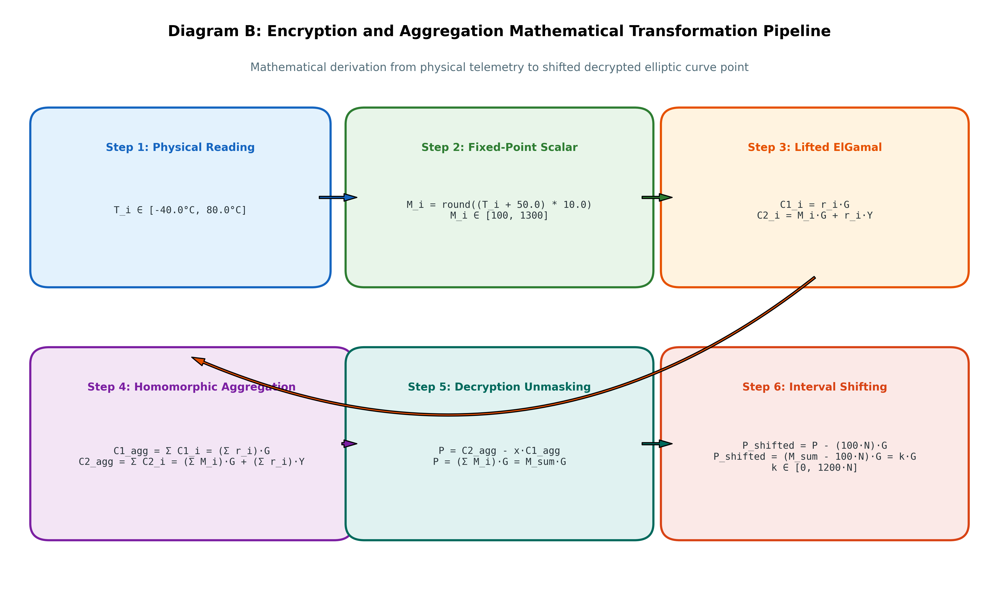
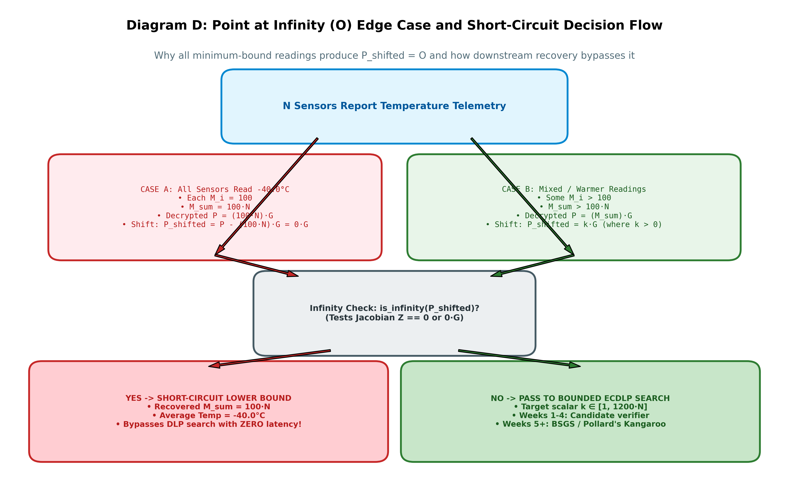

# Mathematical Foundations: EC Lifted ElGamal & Interval Shifting

## 1. Elliptic Curve Parameters: NIST P-256 (secp256r1)

The cryptosystem is instantiated over the standard NIST P-256 prime curve defined over the finite field $\mathbb{F}_p$ by the short Weierstrass equation:

$$y^2 \equiv x^3 + a x + b \pmod p$$

Where:
- Field prime $p = 2^{256} - 2^{224} + 2^{192} + 2^{96} - 1$
  $$p = \text{0xFFFFFFFF 00000001 00000000 00000000 00000000 FFFFFFFF FFFFFFFF FFFFFFFF}$$
- Curve parameter $a \equiv -3 \pmod p$
- Curve parameter $b = \text{0x5AC635D8 AA3A93E7 B3EBBD55 769886BC 651D06B0 CC53B0F6 3BCE3C3E 27D2604B}$
- Subgroup prime order $q$:
  $$q = \text{0xFFFFFFFF 00000000 FFFFFFFF FFFFFFFF BCE6FAAD A7179E84 F3B9CAC2 FC632551}$$
- Base point generator $G = (G_x, G_y)$:
  $$G_x = \text{0x6B17D1F2 E12C4247 F8BCE6E5 63A440F2 77037D81 2DEB33A0 F4A13945 D898C296}$$
  $$G_y = \text{0x4FE342E2 FE1A7F9B 8EE7EB4A 7C0F9E16 2BCE3357 6B315ECE CBB64068 37BF51F5}$$

---

## 2. Fixed-Point Temperature Encoding

### 2.1 Why Floating-Point Numbers Cannot Be Encrypted Directly
1. Cryptographic groups operate over discrete finite algebraic structures (cyclic groups $\mathbb{G}$ of prime order $q$).
2. Elliptic curve scalar multiplication $k \cdot P$ is only defined for integer scalars $k \in \mathbb{Z}_q$.
3. Floating-point numbers have variable exponents and fractional mantissas which cannot be mapped directly to scalar multiples of a base point $G$ without losing arithmetic precision.

### 2.2 Encoding Formula
To map physical temperatures $T \in [-40.0^\circ\text{C}, 80.0^\circ\text{C}]$ to discrete positive integers:

$$M = \text{round\_away\_from\_zero}((T + 50.0) \times 10.0)$$

- **Level Shift (+50.0):** Eliminates negative values. When $T = -40.0^\circ\text{C}$, $T + 50.0 = 10.0 > 0$.
- **Scale ($\times 10.0$):** Preserves $0.1^\circ\text{C}$ sensor precision (the hardware resolution of DHT22/SHT3x sensors).
- **Scalar Integer Range:**
  $$T = -40.0^\circ\text{C} \implies M = ( -40.0 + 50.0) \times 10.0 = 100$$
  $$T = 0.0^\circ\text{C} \implies M = ( 0.0 + 50.0) \times 10.0 = 500$$
  $$T = 80.0^\circ\text{C} \implies M = ( 80.0 + 50.0) \times 10.0 = 1300$$
  Every valid single-sensor message satisfies $M \in [100, 1300]$.

### 2.3 Rounding Semantics: C99 `lroundf()` vs Python `round()`
Python's standard `round()` uses Banker's rounding (round-half-to-even):
- `round(2.5) == 2`
- `round(3.5) == 4`
- `round(-2.5) == -2`

In embedded C/C++ firmware running on microcontrollers (e.g., ESP32), IEEE 754 `lroundf()` rounds halfway cases away from zero:
- `lroundf(2.5f) == 3`
- `lroundf(3.5f) == 4`
- `lroundf(-2.5f) == -3`

Our implementation `round_away_from_zero(val)` guarantees parity with embedded firmware:

$$\text{round\_away\_from\_zero}(v) = \begin{cases} \lfloor v + 0.5 \rfloor & \text{if } v \ge 0 \\ \lceil v - 0.5 \rceil & \text{if } v < 0 \end{cases}$$

---

## 3. Lifted ElGamal Cryptosystem

### 3.1 Key Generation
1. Decryptor samples a private scalar uniformly at random:
   $$x \xleftarrow{\$} [1, q - 1]$$
2. Computes the public key point via scalar multiplication:
   $$Y = x \cdot G \in \mathbb{G}$$

### 3.2 Encryption
Given encoded plaintext scalar $M \in [100, 1300]$ and recipient public key $Y$:
1. Sample fresh ephemeral scalar:
   $$r \xleftarrow{\$} [1, q - 1]$$
2. Compute ephemeral blinding point:
   $$C_1 = r \cdot G$$
3. Compute masked message point:
   $$C_2 = M \cdot G + r \cdot Y$$
4. Output ciphertext pair $\text{CT} = (C_1, C_2)$.

### 3.3 Additive Homomorphic Aggregation
Given $N$ ciphertexts $\text{CT}_i = (C_{1, i}, C_{2, i})$ for $i \in \{1, \dots, N\}$:

$$C_{1, \text{agg}} = \sum_{i=1}^N C_{1, i} = \sum_{i=1}^N (r_i \cdot G) = \left(\sum_{i=1}^N r_i\right) \cdot G$$

$$C_{2, \text{agg}} = \sum_{i=1}^N C_{2, i} = \sum_{i=1}^N (M_i \cdot G + r_i \cdot Y) = \left(\sum_{i=1}^N M_i\right) \cdot G + \left(\sum_{i=1}^N r_i\right) \cdot Y$$

Let:
$$M_{\text{sum}} = \sum_{i=1}^N M_i, \quad r_{\text{sum}} = \sum_{i=1}^N r_i \pmod q$$

Then the aggregate ciphertext is:
$$\text{CT}_{\text{agg}} = (C_{1, \text{agg}}, C_{2, \text{agg}}) = (r_{\text{sum}} \cdot G, \, M_{\text{sum}} \cdot G + r_{\text{sum}} \cdot Y)$$

### 3.4 Decryption Point Computation (Unmasking)
Using private key $x$ (since $Y = x \cdot G$):

$$P = C_{2, \text{agg}} - x \cdot C_{1, \text{agg}}$$
$$P = (M_{\text{sum}} \cdot G + r_{\text{sum}} \cdot Y) - x \cdot (r_{\text{sum}} \cdot G)$$
$$P = M_{\text{sum}} \cdot G + r_{\text{sum}} (x \cdot G) - r_{\text{sum}} (x \cdot G)$$
$$P = M_{\text{sum}} \cdot G$$

> **Important:** This produces the elliptic curve point $P = M_{\text{sum}} \cdot G$. The plaintext integer $M_{\text{sum}}$ is locked in the exponent (discrete logarithm problem).

---

## 4. Interval Shifting & Search Window Bounds

Because each sensor reports $T_i \in [-40.0^\circ\text{C}, 80.0^\circ\text{C}]$, the encoded scalar is bounded by $M_i \in [100, 1300]$.
For $N$ participating sensors, the total sum is bounded by:

$$M_{\text{sum}} \in [100 \cdot N, \, 1300 \cdot N]$$

The interval width is:
$$W = (1300 \cdot N) - (100 \cdot N) + 1 = 1200 \cdot N + 1$$

To position the discrete logarithm search window starting at zero, the Decryptor applies the **baseline correction shift**:

$$P_{\text{shifted}} = P - (100 \cdot N) \cdot G$$

Substituting $P = M_{\text{sum}} \cdot G$:
$$P_{\text{shifted}} = (M_{\text{sum}} - 100 \cdot N) \cdot G = k \cdot G$$

Where:
$$k = M_{\text{sum}} - 100 \cdot N \in [0, \, 1200 \cdot N]$$

---

## 5. The Point at Infinity ($\mathcal{O}$) Edge Case

When all $N$ sensors report the minimum temperature $T_i = -40.0^\circ\text{C}$:
$$M_i = 100 \implies M_{\text{sum}} = 100 \cdot N$$

The shifted point evaluates to:
$$P_{\text{shifted}} = (100 \cdot N - 100 \cdot N) \cdot G = 0 \cdot G = \mathcal{O}$$

### 5.1 Projective Coordinate Definition
In Jacobian projective coordinates $(X : Y : Z)$, the affine curve coordinates are related by:
$$x = X / Z^2, \quad y = Y / Z^3$$
The Point at Infinity $\mathcal{O}$ corresponds to the equivalence class with $Z = 0$ (represented as $(0 : 1 : 0)$).

### 5.2 Why Explicit Handling is Mandatory
Downstream discrete logarithm algorithms (BSGS in Week 5, Pollard's Kangaroo in Week 6) extract affine coordinates (e.g., $\operatorname{SHA256}(X)$). Attempting to convert $\mathcal{O}$ to affine coordinates causes an undefined operation ($Z=0$).

By checking `is_infinity(P_shifted)` first:
1. If True: Immediately return $M_{\text{sum}} = 100 \cdot N$, yielding $T_{\text{avg}} = -40.0^\circ\text{C}$ with **zero latency** and **zero search cost**.
2. If False: Proceed to search $k \in [1, 1200 \cdot N]$.
